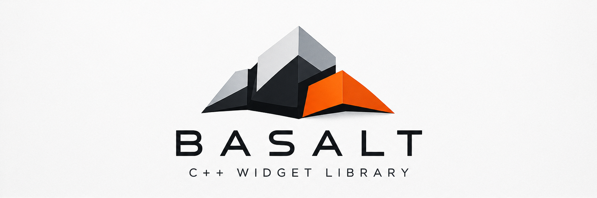

<p align="center">
  
</p>

# Basalt

[](https://basalt.nadiasvertex.workers.dev/)

Basalt is a C++23 widget library that follows the Cubit design system. It provides a widget tree
with layout, input routing, focus and accessibility, a set of standard widgets, and Unicode text
shaping and layout through HarfBuzz. Basalt produces paint commands rather than pixels, so an
application supplies the window and the renderer. It builds with plain CMake and can be used from
source or as an installed package.

## Contents

The library has three layers.

- **Core:** geometry, units, color, typography, the theme resolved from Cubit tokens, the widget
  tree, layout, input events, event routing, focus and accessibility.
- **Text:** font discovery and fallback, shaping, bidirectional text, line breaking, paragraphs and
  multi-paragraph layout.
- **Widgets:** box, stack, scroll view and scroll bar, split view and splitter, label, button, menu
  and menu bar, tabs, text field, text line, status bar, progress bar, diagnostics list, separator,
  image view, dialog, palette, overlay host, toggle, checkbox and checkbox group, and radio button
  and radio group, chip and chip group, select, popover, accordion, avatar, navigation bar, uploader, and tooltip.

`basalt/basalt.h` includes every public header.

The [documentation](docs/index.md) has an overview, an architecture description, and a getting-started
guide. `just docs` builds it as HTML, and `just docs pdf` builds it as PDF.
`just website` builds the HTML with diagrams and copies it to `website/docs/`. Diagrams need
Graphviz (`dot`).

## Requirements

Basalt needs CMake 3.25 or later and a C++23 compiler and standard library, including
`std::expected` and `<print>`. CI builds and tests it with GCC 14 and Clang 20 on Ubuntu 24.04,
Apple Clang on macOS 26, and MSVC from Visual Studio 2022 on Windows. Clang 18 and older cannot use
libstdc++'s `std::expected`. HarfBuzz and, for the tests, Catch2 are downloaded at configure time
unless you provide them.

## Building

The presets build into `.build/<preset>`:

```sh
cmake --preset debug
cmake --build --preset debug
ctest --preset debug
```

With [just](https://github.com/casey/just) installed, `just test` does the same. `just --list` shows
the other recipes.

## Using Basalt in Another Project

Link the target `basalt::basalt`. There are three ways to bring it into a CMake build.

### FetchContent

```cmake
include(FetchContent)
FetchContent_Declare(basalt
  GIT_REPOSITORY https://github.com/nadiasvertex/basalt.git
  GIT_TAG v0.1.0)
FetchContent_MakeAvailable(basalt)

target_link_libraries(my_app PRIVATE basalt::basalt)
```

### add_subdirectory

```cmake
add_subdirectory(third_party/basalt)
target_link_libraries(my_app PRIVATE basalt::basalt)
```

### find_package

Install Basalt, or unpack a [release archive](#release-archives), and add its prefix to
`CMAKE_PREFIX_PATH`:

```sh
cmake --preset release
cmake --build --preset release
cmake --install .build/release --prefix /opt/basalt
```

```cmake
find_package(basalt 0.1 CONFIG REQUIRED)
target_link_libraries(my_app PRIVATE basalt::basalt)
```

When Basalt is included in another project, its tests, tools and install rules are off by default,
and its warning flags apply only to its own sources. `tests/consumer` is a small project that uses
each of these methods.

## Release Archives

Each release on GitHub has prebuilt archives with the headers, Debug and Release static libraries
and the CMake package, plus a `SHA256SUMS` file. The Debug library has a `d` suffix, and
`find_package` picks the configuration that matches your build. The archives carry the toolchain
they were built with:

| Archive | Built with | Needs |
| ------- | ---------- | ----- |
| `basalt-<version>-linux-x86_64.tar.gz` | GCC 14 on Ubuntu 24.04 | glibc 2.39 or later and the libstdc++ from GCC 14 or later |
| `basalt-<version>-macos-arm64.tar.gz` | Apple Clang on macOS 26 | macOS 26 or later on Apple silicon |
| `basalt-<version>-windows-x64.zip` | MSVC from Visual Studio 2022 | Visual Studio 2022 17.14 or later, dynamic runtime (`/MD`, `/MDd`) |

For other setups, build from source with one of the methods above.

## Options

| Option | Default | Effect |
| ------ | ------- | ------ |
| `BASALT_BUILD_TESTS` | on when top level | Build the Catch2 test suite. |
| `BASALT_BUILD_TOOLS` | on when top level | Build the token generator. |
| `BASALT_INSTALL` | on when top level | Add install rules and the CMake package. |
| `BASALT_HARFBUZZ` | `bundled` | `bundled` compiles HarfBuzz into the library. `system` uses an installed HarfBuzz. |
| `BASALT_WARNINGS_AS_ERRORS` | on when top level | Treat warnings in Basalt's sources as errors. |
| `BASALT_SANITIZE` | off | Address and undefined-behavior sanitizers on Clang and GCC. |

## HarfBuzz

By default HarfBuzz is compiled into `libbasalt` from its single-file source, with every optional
backend off. The installed package is then one static archive with no other link dependencies. If
your project already links HarfBuzz, set `BASALT_HARFBUZZ=system` so that the program has only one
copy. Basalt then looks for HarfBuzz's CMake package first and pkg-config second.

The dependency versions and their checksums are in `cmake/dependency_pins.cmake`. To build without
network access later, download and unpack the pinned sources once, then pass the generated initial
cache file when you configure:

```sh
cmake -D BASALT_SOURCES_DIR=.build/sources -P cmake/fetch_sources.cmake
cmake --preset debug -C .build/sources/init.cmake
```

You can also set `FETCHCONTENT_SOURCE_DIR_HARFBUZZ` and `FETCHCONTENT_SOURCE_DIR_CATCH2` to your own
copies.

## Design Tokens

`generated/basalt/tokens.h` holds the Cubit design tokens as C++ constants. It is generated by
`tools/basalt_tokens` from the Cubit DTCG token files and committed. Regenerate it with
`just tokens <tokens directory>`, and do not edit it by hand.

## Tests

The text tests that only need Latin script use Noto Sans from `tests/data/fonts`, so they give the
same results on every machine. Tests of system font discovery and of other scripts use the
machine's fonts, and skip when a script they need is not installed.

## License

Basalt is under the Apache License 2.0; see `LICENSE`. In the default bundled mode the library
contains HarfBuzz, which is under an MIT-style license. Installs and release archives include both
licenses in `share/doc/basalt`. The fonts in `tests/data/fonts` are under the SIL Open Font License;
see `tests/data/fonts/OFL.txt`. They are used only by the tests and are not installed.
