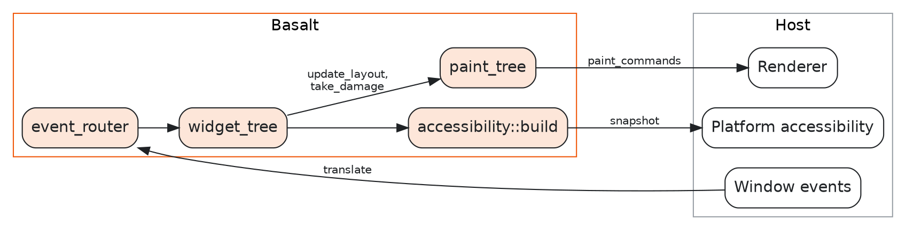

# Architecture

Basalt has one central object, the widget tree. The host feeds events into it and reads paint
commands out of it. This chapter describes each part and the order in which they run.

## Host boundary

The host is your application. The host and Basalt exchange data in one loop.

The host does four jobs:

1. It translates platform input into `basalt::event` values.
2. It tells the tree the viewport size and the display scale.
3. It runs the frame cycle when the tree asks for a frame.
4. It draws the paint commands.

All positions in Basalt are *layout pixels*. A layout pixel is a window coordinate before the
display scale. The renderer multiplies by the display scale to get device pixels.

## Widget tree

A `widget_tree` owns the root widget of one window. It also holds the state that all widgets in
that window share: the theme, the scale factors, keyboard focus, pending layout, and damage.

A `widget` is a node. It owns its children through `std::unique_ptr`. Because a parent owns its
children, a tree has no cycles. Code that must refer to a widget from outside the tree uses a
`widget_id`.

You make a custom widget by deriving from `widget`. You then override the hooks you need:

| Hook | Purpose |
| ---- | ------- |
| `on_measure` | Report the size the widget wants. |
| `on_layout` | Set the bounds of the children. |
| `on_paint` | Record the widget's drawing. |
| `on_paint_overlay` | Record drawing that must appear above the children. |
| `on_event` | Handle an event. Return `true` when the event is handled. |
| `accessibility_info` | Describe the widget to assistive technology. |
| `on_attached`, `on_detached` | React when the widget joins or leaves a tree. |

A widget is detached, attaching, attached, or detaching. `on_attached` runs parent-first.
`on_detached` runs children-first.

## Frame cycle

The tree does not draw by itself. It asks the host for a frame, and the host runs the cycle.

1. The tree calls the handler set with `set_frame_request_handler`. This happens once, when the
   tree goes from idle to needing a frame.
2. The host calls `advance_animations` with a monotonic time.
3. The host calls `update_layout`.
4. The host calls `take_damage`. The result is the list of areas that need repaint. Taking the
   damage completes the frame request.
5. The host calls `paint_tree` and draws the commands.
6. The host calls `collect_garbage`. This destroys widgets that were removed with
   `destroy_later`.

`needs_frame()` reports whether the tree needs another frame. A host that polls can use it
instead of the handler.

## Layout

Layout has two passes. The first pass is measurement. The second pass is placement.

`widget::measure` returns the size that a widget wants within a set of `constraints`. The
tree remembers the answer until layout is invalidated. Measurement must not change the tree.

`widget::on_layout` runs top-down. A container sets the bounds of each child with `set_bounds`.
Changing a size marks the widget for layout, so the children of a resized widget are laid out in
the same pass.

`invalidate_layout` marks a widget and all its ancestors. Widgets call it when their content
changes. You rarely call it yourself.

Lengths use units. A fixed length scales with zoom. A relative length also scales with the
user's text-size preference. `widget::resolve` converts a length to layout pixels.

## Painting

`paint_tree` walks the tree back to front and records `paint_commands`. A `paint_commands` value
is a `std::vector` of a `std::variant` of command types:

- fill and stroke commands for rectangles and rounded rectangles,
- line commands,
- glyph-run and image commands,
- push and pop commands for clip, transform, and layer.

Widgets do not create commands directly. They call functions on `render_context`. Clip,
transform, and layer calls return a scope object. The previous state returns when the scope is
destroyed.

The host renderer reads the commands in order. A renderer needs one case for each command type.
The Skia example in `examples/common/skia_replay.cpp` is a complete renderer.

Each widget paints inside its own bounds and its own coordinates. The tree clips children to the
bounds of the parent. A disabled subtree is drawn in a layer at the theme's disabled opacity.

## Input and focus

An `event` is a `std::variant` of pointer, wheel, key, text input, IME, window, command, and file
drop events. The host creates these values and passes them to `event_router::dispatch`.

The router sends pointer events to the widget under the pointer. It sends keyboard events to the
focused widget. An event bubbles from the target up to the root until a widget returns `true`
from `on_event`. The router skips disabled widgets.

The `focus_manager` of the tree tracks keyboard focus. A press focuses the innermost widget that
accepts focus by click. An unhandled Tab moves focus to the next widget. Each widget has a
`focus_policy` and a `focus_scope`.

Each widget has an `interaction_state` with the hover, press, and focus flags. Widgets read these
flags when they paint.

The host must call `router.update_hover()` after layout. Widgets can move under a pointer that
did not move.

## Accessibility

A widget describes itself with `accessibility_info`. The call `accessibility::build(tree)`
produces an immutable `accessibility::tree`. The tree contains nodes with a role, a name, a
state, and a list of actions.

The snapshot does not refer to widgets. A platform bridge keeps one snapshot, builds the next
one, and sends the difference to the platform. Basalt does not include a platform bridge.

## Text

The text layer is in the `basalt::text` namespace. It has four parts.

| Type | Purpose |
| ---- | ------- |
| `font_manager` | Finds fonts and chooses fallbacks. It reads only the fonts you add. |
| `text_shaper` | Converts text to glyph runs with HarfBuzz. |
| `paragraph` and `text_layout` | Break text into lines and lay out paragraphs. |
| `bidi` and `line_break` | Implement the Unicode bidirectional and line-break algorithms. |

HarfBuzz is a private dependency. No public header includes it.

The tree holds a pointer to a `text_shaper`. The host must keep the shaper alive for as long as
the tree uses it. Without a shaper, text measures as zero width.

A `text_shaper` is not thread-safe. Shaping changes the scale of a font that all callers of the same
`font_manager` share. Use one thread for each `font_manager`.

## Theme

A `theme` holds the resolved Cubit tokens for one color scheme and one density. Create one with
`make_theme(color_scheme, density)`. Widgets read colors, sizes, and text styles from
`tree.theme()`. Call `tree.set_theme` to change the theme. The change repaints the whole tree.

The raw token values are in `generated/basalt/tokens.h`. Do not edit this file. Regenerate it
with `just tokens`.
