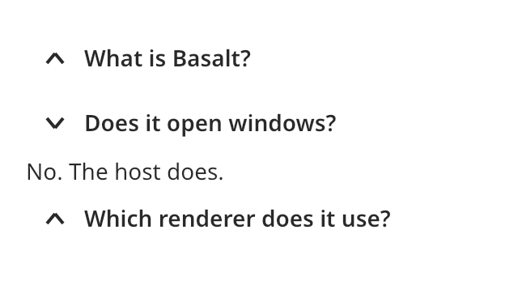

## Accordion

An accordion is a column of sections. Each section has a heading and content. The user clicks
the heading to show or hide the content. Use an accordion for long pages where the user reads
one section at a time, such as a list of questions and answers.



### Create and configure

Create an `accordion` and call `add_item` with a heading and a content widget. `add_item`
returns the `accordion_item`. You can pass no content and set it later with `set_content` or
`emplace_content`.

- `set_exclusive(true)` lets only one item stay open. By default any number of items stay open.
- `set_appearance` picks `plain`, `outlined` or `filled`.
- `set_chevron` puts the chevron at the `start` or the `end` of the heading.
- `set_size` picks a `control_size`.
- `expand_all()` and `collapse_all()` change every item.

On an item, `set_expanded` opens or closes it, and `toggle()` does what a click does. An item
can also hold actions at the end of its header. Use `set_actions` for them.

### Events

An item calls the handler from `set_on_toggle` with the new state after the user opens or closes
it. The header is a button. Enter, Space and a click toggle it.

### Example

The program `examples/widgets/accordion.cpp` makes an exclusive accordion of three questions. It opens the second item with a click and prints that the first item closed.

```{.cpp include="examples/widgets/accordion.cpp"}
```
