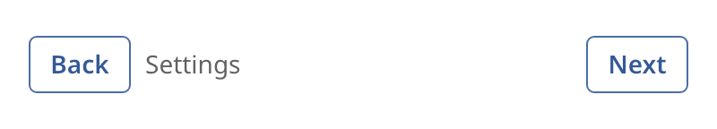

## Box

A box places its children in a row or a column. It is the basic layout widget. Most windows are
built from nested boxes.



### Create and configure

Pass `axis::horizontal` for a row or `axis::vertical` for a column. Add children with
`emplace_child` or `add_child`. These calls use the default item settings.

- `set_gap` sets the space between children.
- `set_padding` sets the space inside the edges. Use `length_insets::uniform` for equal padding.
- `set_main_alignment` places the children along the box direction when there is spare space.
- `set_cross_alignment` places the children across the box direction. The default is `stretch`.

To change how one child is sized, call `add(child, box_item{...})` or `set_item`. A `box_item`
has these fields:

| Field | Meaning |
| ----- | ------- |
| `grow` | The share of spare space that the child takes. |
| `shrink` | The share of a shortage that the child gives up. |
| `basis` | The size along the box direction before growing or shrinking. |
| `min`, `max` | The smallest and the largest size along the box direction. |
| `align` | The cross alignment of this child. |

Lengths are token lengths. Use `fixed(16)` for 16 token pixels. The display scale and the zoom
change the result.

### Events

A box does not handle input. Its children receive events as usual.

### Notes

A child with `grow` of 1 in a row takes all spare width. Two children with the same `grow` share
it equally. The example sets the cross alignment of the content to `stretch`, so the row fills
the window.

### Example

The program `examples/widgets/box.cpp` builds a row with a Back button, a title that grows, and a Next button. It prints the width of each child.

```{.cpp include="examples/widgets/box.cpp"}
```
