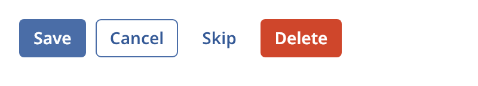

## Button

A button starts an action. The user presses it with the pointer, or with Enter or Space while it
has focus. The button is a Tab stop, and a click gives it focus.



### Create and configure

Pass a label and an optional press handler to the constructor.

- `set_variant` picks `primary`, `secondary`, `tertiary` or `danger`. Use one primary button for
  the main action of a view. The default is `secondary`.
- `set_label` changes the text.
- `set_label_alignment` places the label inside the button. The default is `center`.
- `set_shortcut` sets a text such as `Ctrl+S`. Assistive technology announces it. Basalt does not
  bind the key.
- `set_on_press` sets the handler.
- `press()` does what a click does. It returns `false` when the button is disabled.

### Events

The handler runs when the user releases the primary pointer button over the button, or presses
Enter or Space. A disabled button stays focusable and does nothing.

A button that opens a popover calls `popover::toggle` from its handler. See [Popover](popover.md).

### Example

The program `examples/widgets/button.cpp` shows the four variants in a row. It clicks the primary button and prints the number of presses.

```{.cpp include="examples/widgets/button.cpp"}
```
