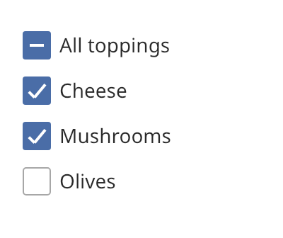

## Checkbox

A checkbox is an independent choice with the states unchecked, checked and mixed. Use a
`checkbox_group` for a list of related options. A group can add a select-all checkbox.



### Create and configure

For a single box, pass a label, an optional `accessibility::check_state` and an optional
`control_size`. `state()` and `checked()` read the value. `set_state` changes it.

A `checkbox` is a `choice_control`. It also has these functions:

- `set_helper_text` shows text below the label. In the error state it holds the error message.
- `set_error` turns the error state on or off.
- `activate()` does what a click does.

For a group, create a `checkbox_group` with a name. Call `enable_select_all` before you add
options. Then call `add_option` for each option. It returns the `checkbox`. `option(index)` and
`checked_count()` read the group.

### Events

A single box calls the handler from `set_on_change` with the new `check_state`. A group calls its
handler with the index of the option that changed. Activating a mixed box checks it.

The select-all box is checked when all options are checked. It is mixed when only some are
checked. Checking it checks every option.

### Example

The program `examples/widgets/checkbox.cpp` creates a group of three toppings with a select-all box. It clicks the second option and prints the number of checked options.

```{.cpp include="examples/widgets/checkbox.cpp"}
```
