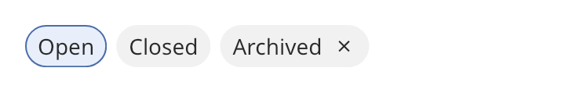

## Chip

A chip is a small pill with a label. Chips show tags, filters and values that the user can
remove. A chip can be selectable, removable or both. A `chip_group` places chips in rows that
wrap at the width of the group.



### Create and configure

Create a `chip_group` with a name and a `chip_selection`: `none`, `single` or `multiple`. With
`single`, selecting a chip deselects the others. Call `add_chip` to add a chip. It returns the
`chip`.

On a chip:

- `set_selectable(true)` lets the user toggle the chip.
- `set_removable(true)` shows a remove mark.
- `set_error` and `set_loading` set the error and the busy states. A loading chip ignores input.
- `set_max_width` limits the width. A tooltip shows the full label of a shortened chip.
- `toggle()` and `remove()` do what a click does.

On a group, `selected_indices()` returns the selected chips. `set_remove_all_label` shows a button
that removes all removable chips. `remove_all()` does the same from code.

### Events

A chip calls the handler from `set_on_toggle` with the new state. It calls the handler from
`set_on_remove` when the user removes it. The Delete and Backspace keys also remove a removable
chip. A group calls `set_on_change` with the index of the chip that changed. A removed chip leaves
its group.

### Notes

Give a chip group a limited width. In a box, set the cross alignment to `stretch`, as the example
does. Then the chips wrap at the width of the box.

### Example

The program `examples/widgets/chip.cpp` makes a group with multiple selection, clicks the first chip and prints its state.

```{.cpp include="examples/widgets/chip.cpp"}
```
