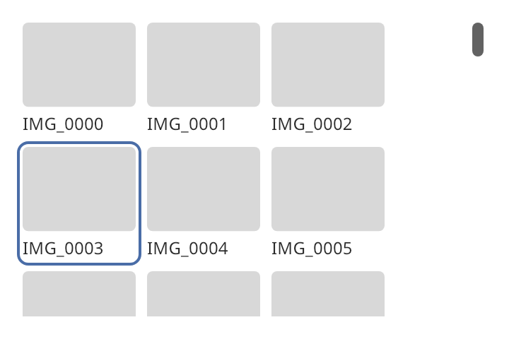

## Collection view

A collection view shows a large collection as rows of equal cells. It makes widgets only for the
rows that are in view and a margin around them. Use it for photo galleries and other collections
that can hold thousands of items. Use a [grid view](grid_view.md) when the cells can be painted
without widgets. Use a [tree view](tree_view.md) for rows of text, and a
[scroll view](scroll_view.md) for content of a fixed size.



### Create and configure

Set the item count, the cell size and a cell factory.

- `set_item_count(count)` makes one section of `count` items. `set_sections` makes several
  sections. Each `grid_section` has a count and a flag for a header.
- `set_cell_size(width, height)` sets the size of every cell. `set_gap` sets the space between
  cells and between rows. The grid computes the number of columns from its width. A grid that is
  narrower than one cell has one column.
- `set_cell_factory` sets the function that makes a cell. It takes the item index and a widget
  that the grid no longer needs, or null. It returns the widget to show. To save work, update
  the widget that it received and return it.
- `set_header_factory` and `set_header_height` set the headers of sections that have one. A header
  is as wide as the grid. The grid creates a header when its section comes into view and destroys
  it when the section leaves.
- `set_margin_rows` sets how many rows beyond the view have widgets. The default is two.
- `reload()` runs the factory again for every cell that has a widget. Call it when the data behind
  the cells changed but the counts did not. `set_item_count`, `set_sections` and the size
  functions do the same.

The grid keeps a pool of cells that left the margin. When a cell is needed, the grid takes one
from the pool and gives it to the factory as the widget to reuse. A grid of 50,000 items that
shows 50 cells makes about 60 widgets.

### Load work for the items in view

`set_on_visible_change` calls its handler with an `index_range` when the range of items in view
changes. The range does not include the margin. Use it to start loading what the cells need and to
cancel loads for items that left. `visible_items()` and `realized_items()` return the current
ranges. `cell(index)` returns the widget for an item, or null when the item has no widget.

The handler runs during layout. It must not add or remove widgets of the grid.

### Scrolling

The grid scrolls vertically. A scroll bar shows over the right edge when the content is taller
than the grid. `scroll_to_item(index)` scrolls as little as possible to show an item. It works
before the first layout. `scroll_offset()` and `set_scroll_offset()` read and set the position in
layout pixels.

### Events

The grid is a Tab stop. It keeps a current item, which `current()` reads and `set_current` sets.
`set_current` scrolls to the item and does not call a handler.

| Key | Effect |
| --- | ------ |
| Left, Right | Move to the previous or next item. |
| Up, Down | Move one row. The column stays the same where the row has it. |
| Page Up, Page Down | Move by the number of rows that fit in the grid. |
| Home, End | Go to the first or last item. |
| Enter, Space | Activate the current item. |

When no item is current, the first movement key makes the first item in view current. Home and End
go to the ends at once.

- `set_on_current_change` calls its handler with the item when a key or a click moves the current
  item.
- `set_on_activate` calls its handler with an item when the user presses Enter or Space on it or
  clicks it. A click on a cell that handles the click itself does not reach the grid.

The focus ring surrounds the current cell.

### Geometry

`layout()` returns the `grid_layout` for the current width. It answers where an item goes, which
items overlap a vertical span and which item is above or below another, without a widget. It works
on its own, so a program can use it to plan loads.

### Example

The program `examples/widgets/collection_view.cpp` makes a grid of 10,000 picture tiles. It moves the
current item with the keyboard, activates one, scrolls to item 5,000 and back to the start, and prints
what the handlers report.

```{.cpp include="examples/widgets/collection_view.cpp"}
```
