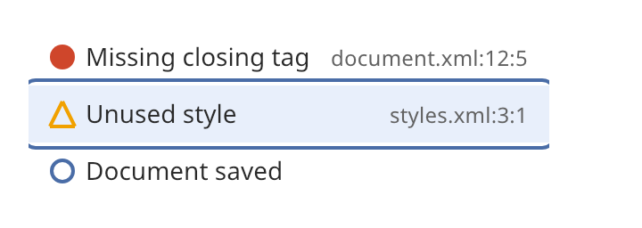

## Diagnostics list

A diagnostics list shows problems, one row each. Use it for validation errors, build warnings
and notes. The icon of each row has a different shape for errors, warnings and notes. The shape,
and not only the color, tells the severity.



### Create and configure

Create a `diagnostics_list` and call `set_entries` with a vector of `diagnostic_entry` values. An
entry has a `severity` (`error`, `warning` or `info`), a `message` and a `location`. Basalt shows
the location but does not read it.

- `set_empty_message` sets the text that shows when the list has no entries.
- `focus_row(index)` moves keyboard focus to a row. `focused_index()` reads it.
- The list is as tall as its rows. Put it in a [scroll view](scroll_view.md) to scroll it.

### Events

Tab enters the list. Up, Down, Home and End move among the rows. A click, Enter or Space on a row
calls the handler from `set_on_activate` with the row index and its entry. Use it to go to the
location in your document.

### Example

The program `examples/widgets/diagnostics_list.cpp` fills a list with three entries, focuses the second row and presses Enter. It prints the location of that entry.

```{.cpp include="examples/widgets/diagnostics_list.cpp"}
```
