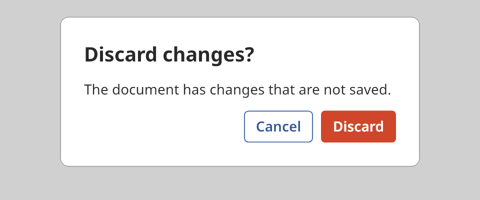

## Dialog

A dialog is a message with a title and a row of buttons. It asks the user for a decision, such as
whether to discard changes. The dialog shows above the window and blocks the content below it
until the user answers.



### Create and configure

Pass a title, a message, a list of `dialog_button` values and an optional cancel index to the
constructor. A `dialog_button` has a label and a `button_variant`. Show the dialog with
`overlay_host::show_dialog`. That call needs a host above the dialog. See
[Overlay host](overlay_host.md).

- The message wraps at about `dialog::wrap_columns` characters. Line breaks in the message stay.
- Focus starts on the first button.
- `choose(index)` presses a button from code. It returns `false` when the index is out of range.

### Events

The handler from `set_on_choice` receives the index of the chosen button. Escape chooses the
button at the cancel index.

The dialog does not close itself. In the handler, call `overlay_host::dismiss` with the identifier
that `show_dialog` returned.

```cpp
auto const id = host.show_dialog(std::move(shown));
window.set_on_choice([&host, id](std::size_t) { host.dismiss(id); });
```

The example does not dismiss the dialog, so that the screenshot shows it.

### Example

The program `examples/widgets/dialog.cpp` shows a dialog with a Cancel button and a Discard button. It chooses the second button and prints its index.

```{.cpp include="examples/widgets/dialog.cpp"}
```
