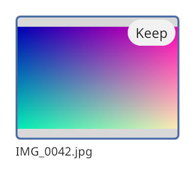

## Image tile

An image tile shows a picture with an optional caption. It is made for the cells of a
[collection view](collection_view.md). The tile scales the picture to fit and keeps its aspect ratio. Before a
picture is set, the tile shows a plain placeholder, so a grid can show a tile while its picture
loads.



### Create and configure

Create the tile and call `set_image` with a `raster_image_ptr`. Basalt does not decode image
files. Decode the file in your program first.

- `set_caption` shows a line of text under the picture. An empty caption removes the line.
- `set_description` sets the text that assistive technology reads. It falls back to the caption.
- `set_selected` shows an accent border around the picture.
- `set_badge(corner, widget)` puts a widget in a corner of the picture. The tile gives the badge
  its natural size. A null widget removes the badge. Use `tile_corner` to name the corner.
- `picture_area()` and `picture_bounds()` return the area above the caption and the rectangle that
  the picture takes inside it. `picture_bounds()` is empty without a picture.

The tile takes the size its parent gives it. A collection view sets the size of its cells.

Unlike an [image view](image_view.md), the tile also scales a picture up, to fill the area. Give
the tile a picture that has about the size of the cell, so that it is not enlarged much.

### Events

An image tile does not handle input. A collection view handles clicks and keys for its cells.

### Example

The program `examples/widgets/image_tile.cpp` makes a gradient picture and shows it in a tile with
a caption and a badge. It prints the size that the picture takes.

```{.cpp include="examples/widgets/image_tile.cpp"}
```
