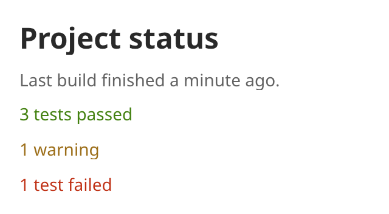

## Label

A label shows one line of text that the user cannot edit. Use it for headings, captions and
status text. The label clips its text to its bounds.



### Create and configure

Pass the text and an optional `text_role` to the constructor.

- `set_role` picks the theme text style, from `body` to `heading_large`. `source` uses the
  monospace family.
- `set_tone` picks the semantic color: `normal`, `subdued`, `interactive`, `danger`, `warning` or
  `success`.
- `set_heading_level` marks the label as a heading for assistive technology. It does not change
  the look. Set the role for the look.
- `set_text` changes the text.

### Events

A label does not handle input.

### Notes

A label has one line. To show a longer text, use a multi-line [text field](text_field.md) in
read-only mode. A parent that wants to show all of a label gives it the measured width.

### Example

The program `examples/widgets/label.cpp` shows a heading and four status lines in different tones.

```{.cpp include="examples/widgets/label.cpp"}
```
