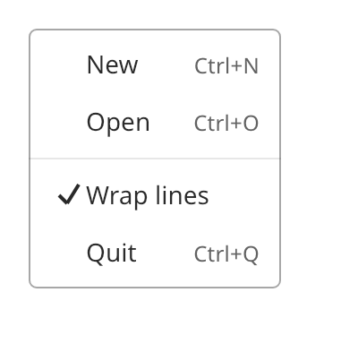

## Menu

A menu is a list of commands. Each item has a label, an optional shortcut hint and an optional
check mark. The menu draws its own panel. Whoever shows the menu places it and closes it.
`menu_bar`, `select` and `navigation_bar` use menus. You can also show a menu as a context menu
with `overlay_host::show_popup`.



### Create and configure

Create a `menu` with a name. Call `add_item(id, label, shortcut, checked)` for each command. It
returns the `menu_item`. `add_separator()` adds a line. `find_item(id)` returns the item with that
identifier or null.

- A `checked` value of `true` or `false` adds a check column. An empty value makes a plain item.
- `set_shortcut` and `set_label` change an item.
- `activate()` on an item does what a click does. It returns `false` when the item is disabled.

### Events

The handler from `menu::set_on_activate` receives the identifier of the item that the user
activated. A click, Enter or Space activates an item. Disabled items stay reachable by keyboard
and do nothing. Escape calls the handler from `set_on_dismiss`. The owner then closes the menu.

The items form one focus group. Tab enters the menu at the item that had focus last. Up, Down,
Home and End move among the items and wrap at the ends.

### Example

The program `examples/widgets/menu.cpp` shows a menu with a check item. It clicks the Open item and prints its identifier.

```{.cpp include="examples/widgets/menu.cpp"}
```
