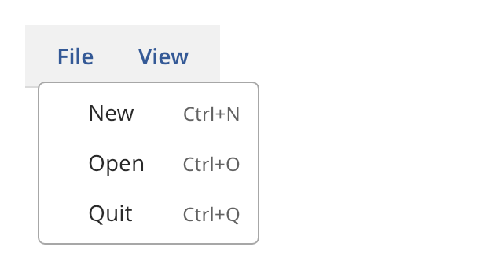

## Menu bar

A menu bar is a row of menu titles along the top of a window. The user chooses a title to open its
menu below the title. The bar opens menus in the nearest `overlay_host`, so the window needs one.



### Create and configure

Create a `menu_bar` and call `add_menu(title, populate)` for each title. The bar calls `populate`
with an empty `menu` each time the menu opens. Build the items in that function. Then the enabled
and the checked states are always current.

- `open_menu(index)` opens a menu from code. It returns `false` when the index is out of range or
  the bar has no host.
- `close_menu()` closes the open menu. `is_open()` tells whether a menu is open.
- `set_menu_visible(index, false)` hides a title. A hidden menu is skipped by layout and focus.

### Events

Choosing an item closes the menu. Then the bar calls the handler from `set_on_command` with the
identifier of the item. Tab enters the bar. Left and Right move among the titles. Enter or Space
opens the focused title.

### Example

The program `examples/widgets/menu_bar.cpp` makes a bar with two menus and opens the File menu.

```{.cpp include="examples/widgets/menu_bar.cpp"}
```
