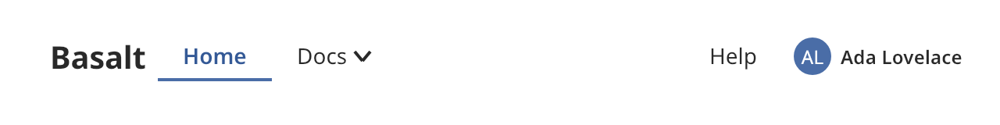

## Navigation bar

A navigation bar runs across the top of an application. The `sections` layout shows leading
actions, a title, navigation sections, center actions, utility links and an avatar. The `toolbar`
layout shows only the title and the actions.



### Create and configure

Create a `navigation_bar` with a name for assistive technology.

- `set_title` sets the title.
- `add_section(id, label)` adds a destination and returns its `navigation_item`. Call
  `add_entry(id, label)` on the item to give it a submenu. An item with entries opens the submenu
  instead of navigating.
- `add_utility_link(id, label)` adds a link such as Help.
- `emplace_leading<T>()` and `emplace_center<T>()` add widgets to the leading and center areas.
- `set_avatar` sets the avatar at the end.
- `set_layout` picks `sections` or `toolbar`.
- `select(id)` marks a destination as selected without calling the handler. `selected_id()` reads
  it.

### Events

The handler from `set_on_navigate` receives the identifier of the section, the submenu entry or the
utility link that the user chose. Sections and their entries also become the selected destination.

### Example

The program `examples/widgets/navigation_bar.cpp` builds a bar with two sections, a utility link and an avatar. It clicks Home and prints the selected destination.

```{.cpp include="examples/widgets/navigation_bar.cpp"}
```
