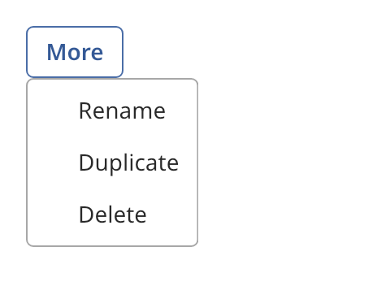

## Overlay host

An overlay host is the root widget of a window. It holds one content widget that fills the
window. It also shows popups and dialogs above the content.



A widget clips its children to its own bounds. A menu that opens below a button must go beyond
the bounds of the button, so it is shown in the host instead.

### Create and configure

Make the host the root of the tree with `tree.emplace_root<overlay_host>()`. Call `set_content`
with the widget that holds your window. `content()` returns it.

| Function | Result |
| -------- | ------ |
| `show_popup(widget, anchor, on_close)` | Shows a popup below the anchor rectangle, or above it when it does not fit. A press outside the popup, or Escape, closes it. The popup blocks the content below and traps focus. |
| `show_hover_popup(widget, anchor, on_close)` | Shows a popup that does not block input. Only `dismiss` and `dismiss_all` close it. Tooltips use it. |
| `show_dialog(widget, on_close)` | Shows the widget in the center over a dimmed window. The owner or Escape closes it. |
| `make_exclusive(id)` | Dismisses the previous exclusive overlay. Popovers use it. |
| `dismiss(id)` | Closes one overlay. It returns `false` when the overlay is already gone. |
| `dismiss_all()` | Closes every overlay. |

Each show function returns a `widget_id`. `is_open(id)` and `overlay_count()` report the state.
`overlay_host::find(widget)` returns the nearest host above a widget, or null.

The `on_close` handler runs once when the overlay goes away, whichever way. Overlays stack. The
most recent one is on top.

### Events

The host sends pointer and keyboard input to the top overlay first. A modal overlay stops the
pointer from reaching the content below it.

### Example

The program `examples/widgets/overlay_host.cpp` shows a menu in a popup below a button. It prints the number of overlays and then dismisses the popup.

```{.cpp include="examples/widgets/overlay_host.cpp"}
```
