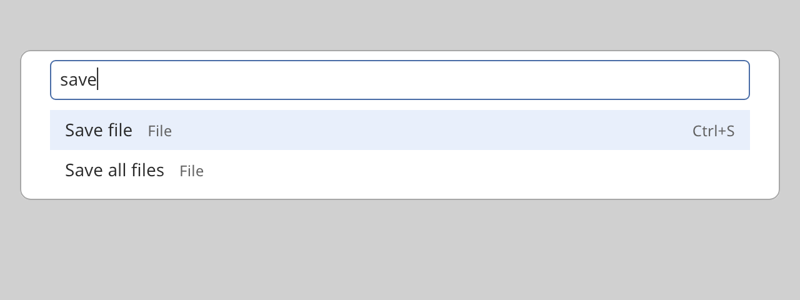

## Palette

A palette is a search box above a short list of choices. Use it for a command palette or a quick
switcher. Show it with `overlay_host::show_dialog`.



### Create and configure

Create a `palette`. Call `set_entries` with a vector of `palette_entry` values. An entry has an
`id`, a `label`, a `detail` (such as a key binding), a `category`, a `state` and a `dimmed` flag.
A dimmed entry is drawn in muted colors and can still be chosen.

The palette does not filter. It reports each change of the query. You answer with `set_entries`,
already ranked. At most `palette::visible_rows` entries show. The list scrolls to keep the
selection in view.

- `set_placeholder` sets the hint text of the search box.
- `set_query` changes the query without calling the handler.
- `set_empty_message` sets the text for an empty list.
- `focus_query()` moves focus to the search box. Call it after you show the palette.
- `select(index)`, `move_selection(delta)` and `choose_selected()` work from code.

### Events

The handler from `set_on_query_change` receives the new query after each edit. The handler from
`set_on_choose` receives the identifier of the chosen entry. A click on a row, or Enter, chooses an
entry. Up, Down, Page Up and Page Down move the selection. Focus stays in the search box.

The palette does not close itself. The choice handler runs first. Then you dismiss the overlay.

### Example

The program `examples/widgets/palette.cpp` shows a palette, filters the entries as the user types, and chooses the selected entry.

```{.cpp include="examples/widgets/palette.cpp"}
```
