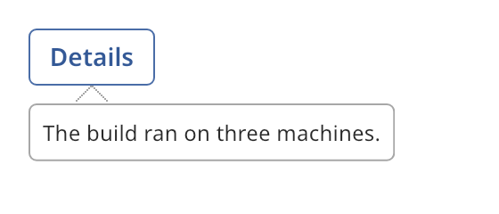

## Popover

A popover is a trigger widget with a panel that shows beside it. A hover popover shows short text
when the pointer rests on the trigger. A click popover shows content that the user can operate.



### Create and configure

Create a `popover` with a `popover_trigger`: `hover` or `click`. Set the trigger widget with
`emplace_trigger<T>()` or `set_trigger`. Then set the content.

- `set_text` shows plain text.
- `set_content` takes a function that builds the content widget. The popover calls it each time
  it opens.
- `set_tip(true)` shows a tip that points at the trigger.
- `set_hover_delay` sets how long the pointer must rest before a hover popover opens.
- `open()`, `close()` and `toggle()` work from code. `open()` returns `false` when there is no
  content, no host or the popover is disabled.
- `is_open()` reads the state.

The panel opens below the trigger, or above it when it does not fit. Only one popover is open
in a host at a time. Opening one closes another. The popover needs an
[overlay host](overlay_host.md) above it.

### Events

`set_on_visibility_changed` calls its handler with `true` when the panel opens and `false` when it
closes. A click popover takes focus when it opens. An outside press or Escape closes it.

A trigger that handles clicks itself, such as a [button](button.md), must call `toggle` from its
own handler. A trigger that leaves clicks unhandled, such as a label, needs no handler.

### Example

The program `examples/widgets/popover.cpp` makes a click popover with a button trigger. It clicks the button and prints that the popover opened.

```{.cpp include="examples/widgets/popover.cpp"}
```
