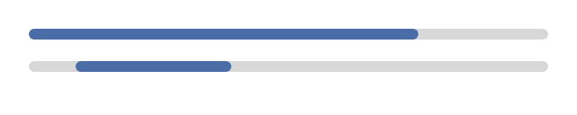

## Progress bar

A progress bar shows how far an operation has come. A bar with a fraction fills from the left. A
bar without a fraction is indeterminate. It shows a short segment that moves along the track.



### Create and configure

Pass a fraction from 0 to 1 to the constructor, or pass nothing for an indeterminate bar.

- `set_fraction` changes the value. It clamps values outside 0 to 1. Pass `std::nullopt` to make
  the bar indeterminate.
- `tick(step)` moves the indeterminate segment by `step` of the track width and repaints. Call it
  once per frame while the operation runs. On a bar with a fraction, `tick` only repaints.
- `fraction()` reads the value.

### Events

A progress bar does not handle input. Assistive technology reads the fraction.

### Example

The program `examples/widgets/progress_bar.cpp` shows a determinate bar and an indeterminate bar. It moves the second bar one step and prints both states.

```{.cpp include="examples/widgets/progress_bar.cpp"}
```
