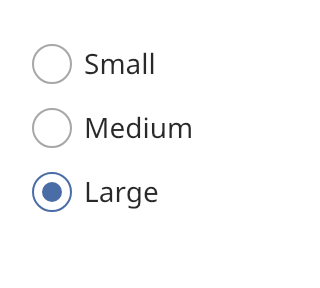

## Radio button

Radio buttons let the user choose one option from a set. Choosing an option clears the others. A
`radio_group` holds the options and enforces this rule.



### Create and configure

Create a `radio_group` with a name and an optional `axis`. Call `add_option(label)` for each
option. It returns the `radio_button`.

- `select(index)` selects an option from code and clears the others. It returns `false` when the
  index is out of range.
- `selected_index()` returns the selected index, or an empty value.
- `option(index)` returns one option.
- `option_count()` returns the number of options.

An option is a `choice_control`. It has `set_helper_text`, `set_error` and `set_size`. Call
`set_selected` on a single option only when you manage the group yourself.

### Events

The handler from `set_on_change` receives the index of the option that the user chose. The group
is one Tab stop. Tab enters it at the selected option. The arrow keys move focus to the next option
and select it.

### Example

The program `examples/widgets/radio_button.cpp` creates a group of three sizes, clicks the last option and prints the label of the selected option.

```{.cpp include="examples/widgets/radio_button.cpp"}
```
