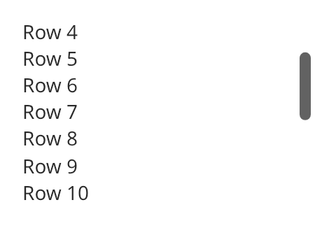

## Scroll view

A scroll view shows a window onto content that is larger than the view. The content is one widget.
Along each scrolling axis, the content takes the size it needs. Along the other axis, it matches
the view.



### Create and configure

Pass a `scroll_axes` value to the constructor: `vertical`, `horizontal` or `both`. Set the content
with `emplace_content<T>()` or `set_content`.

- `set_scrollbars(true)` adds scroll bars. A bar shows only while the content overflows.
- `scroll_by(delta)` and `set_scroll_offset(offset)` move the content at once. They return `true`
  when the offset changed.
- `scroll_into_view(rect)` scrolls as little as possible to show a rectangle in content
  coordinates.
- `scroll_offset()`, `max_scroll_offset()`, `content_size()` and `visible_content_rect()` read the
  state.
- `set_focus_policy(focus_policy::tab)` makes the view a Tab stop, so keys scroll it.

You can request an offset before layout. The view keeps it and clamps it when it knows the size of
the content.

### Events

The wheel always scrolls. Each wheel event moves a target, and the view eases toward it over the
next frames. Key presses, scroll bars and calls from code move the content at once. A focused view
scrolls with the arrow keys, Page Up, Page Down, Home and End.

### Example

The program `examples/widgets/scroll_view.cpp` puts twenty labels in a vertical scroll view with scroll bars, scrolls down by 60 layout pixels and prints the offset.

```{.cpp include="examples/widgets/scroll_view.cpp"}
```
