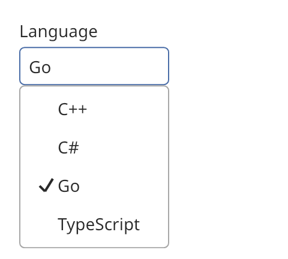

## Select

A select shows the chosen value, or a placeholder, in a field. It opens a list of options in a
popup. The `single` mode chooses one option. The `multiple` mode chooses several. A label shows
above the field. Helper text or an error message shows below it.



### Create and configure

Pass a label and an optional `control_size` to the constructor. Call `add_option(label)` for each
option.

- `set_mode` picks `select_mode::single` or `select_mode::multiple`.
- `set_placeholder` sets the text that shows when nothing is chosen.
- `set_helper_text` sets the text below the field. `set_error(true)` makes it an error message.
- `choose(index, chosen)` changes the choice from code. `clear()` removes it.
- `chosen_indices()` and `is_chosen(index)` read the choice. `option_label(index)` returns the
  label of an option.
- `open()` and `close()` work from code. `open()` returns `false` when the select is disabled, has
  no options or has no host.

The select needs an [overlay host](overlay_host.md) above it.

### Events

`set_on_change` calls its handler without arguments after the user changes the choice. Read the
new choice with `chosen_indices()`. Enter, Space and Down open the list. In `multiple` mode, the
field shows how many options are chosen, and the list stays open while the user toggles options.
Delete and Backspace clear the choice.

### Example

The program `examples/widgets/select.cpp` creates a select with four options, opens it, moves the choice to the third option with the keyboard and prints the choice.

```{.cpp include="examples/widgets/select.cpp"}
```
