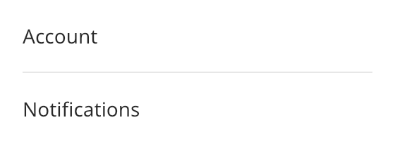

## Separator

A separator is a thin line between groups of controls. A horizontal separator runs from left to
right and stretches across its parent. A vertical separator runs from top to bottom.



### Create and configure

Pass an `axis` to the constructor. The default is `axis::horizontal`. `set_direction` changes it.

A separator takes the width of its parent only when the parent stretches its children. In a box,
set the cross alignment to `stretch`.

### Events

A separator does not handle input.

### Example

The program `examples/widgets/separator.cpp` puts a separator between two labels and prints its width.

```{.cpp include="examples/widgets/separator.cpp"}
```
