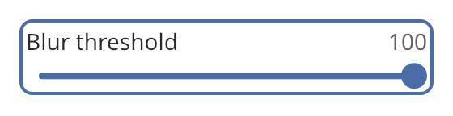

## Slider

A slider picks a number from a range. The user drags a thumb along a horizontal track, clicks on
the track, or uses the keyboard. Use a [text field](text_field.md) when the user must type an
exact value.



### Create and configure

Pass a minimum, a maximum, a step, an initial value and an optional `control_size` to the
constructor. The value is always a multiple of the step counted from the minimum, and it is always
in the range.

- `set_range(minimum, maximum, step)` changes the range. A maximum below the minimum becomes the
  minimum. A step of zero or less becomes one thousandth of the range. The value is adjusted to fit.
- `set_value` rounds the value to a step and clamps it. It does not call a handler. `value()` reads
  it.
- `set_label` shows a label above the track, on the left.
- `set_value_formatter` takes a function from the value to text. The text shows above the track,
  on the right. Without a formatter the slider shows no value text.

### Events

The slider has two handlers. They let an application update a preview while the user drags, and do
costly work only when the choice is final.

- `set_on_change` calls its handler each time the value changes while the user drags or presses a
  key.
- `set_on_commit` calls its handler once when the choice is final. This happens when a drag ends,
  and after each key press or click on the track. A key press at the end of the range commits,
  although the value does not change.

Pressing the track moves the thumb to that point and starts a drag. The pointer can leave the track
during a drag. The value stops at the ends of the range. Escape during a drag restores the value
from before the drag and calls `on_change`. It does not call `on_commit`.

| Key | Effect |
| --- | ------ |
| Left, Down | Decrease the value by one step. |
| Right, Up | Increase the value by one step. |
| Page Down, Page Up | Move by one tenth of the range. |
| Home, End | Go to the minimum or the maximum. |

The slider is a Tab stop. Assistive technology sees a `slider` with the range, the value and the
increment and decrement actions.

### Example

The program `examples/widgets/slider.cpp` makes a slider with a label and value text. It presses
Page Up and End and prints what the two handlers report.

```{.cpp include="examples/widgets/slider.cpp"}
```
