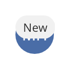

## Stack

A stack layers its children on top of each other. Children are painted in the order that you add
them, so the last child is on top. Use a stack for a badge over an icon, or a placeholder over an
empty editor.



### Create and configure

Add a child with `add(child, stack_item{...})`. A `stack_item` has a `horizontal` and a `vertical`
`alignment`. A child that does not stretch keeps its measured size, limited to the content
rectangle. `emplace_child` uses the default item, which stretches the child.

- `set_padding` insets the content rectangle.
- `set_item(child, item)` changes the placement of a child. It returns `false` when the widget is
  not a child of the stack.

### Events

A stack does not handle input. Its children receive events as usual. The top child is hit first.

### Example

The program `examples/widgets/stack.cpp` puts a New chip on the top right corner of an avatar and prints the size of the stack.

```{.cpp include="examples/widgets/stack.cpp"}
```
