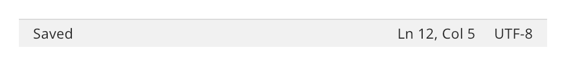

## Status bar

A status bar is a row of text sections along the bottom of a window. Typical sections are a
message, the caret position and the encoding.



### Create and configure

Call `add_section(id, text, grow)` for each section. It returns the `label` of the section. A
section with `grow` above zero takes the spare width. It pushes the sections after it to the right
edge.

- `set_section_text(id, text)` changes a section. It returns `false` when no section has that
  identifier.
- `section(id)` returns the label, or null.
- `set_name` sets the name for assistive technology.

### Events

A status bar does not handle input. It is a polite live region. Assistive technology announces
changes to its sections without moving focus.

### Example

The program `examples/widgets/status_bar.cpp` makes a bar with a growing message and two fixed sections, updates two sections and prints the message.

```{.cpp include="examples/widgets/status_bar.cpp"}
```
