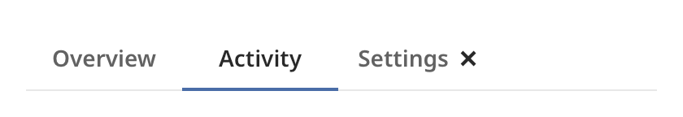

## Tabs

A tab bar is a row of tabs. The user picks one tab to choose a view. The bar reports the selection.
Your program shows the matching content. The bar does not hold the content.



### Create and configure

Create a `tab_bar` with a name. Call `add_tab(label)` for each tab. It returns the `tab`.

- `select(index)` selects a tab and clears the others. It returns `false` when the index is out of
  range. Unlike most setters, it calls the select handler when the selection changed.
- `selected_index()` returns the selected index, or an empty value.
- `tab_at(index)` and `tab_count()` read the tabs.
- `tab::set_closable(true)` shows a close button at the end of a tab.
- `scroll_tab_into_view(index)` scrolls a long row to show a tab.

Tabs shrink toward a minimum width as the row fills. When they no longer fit, the row scrolls
sideways. The wheel or the trackpad scrolls it. A vertical wheel turns sideways.

### Events

`set_on_select` calls its handler with the index of the newly selected tab. `set_on_close` calls its
handler with the index of a tab whose close button the user pressed. The bar does not remove the tab.
Remove or rebuild the tabs in the handler.

The tabs form one focus group. Tab enters at the selected tab. Left, Right, Home and End move among
the tabs and select as they go.

### Example

The program `examples/widgets/tabs.cpp` makes a bar with three tabs, one of them closable. It clicks the second tab and prints the selection.

```{.cpp include="examples/widgets/tabs.cpp"}
```
