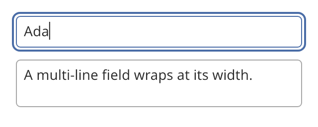

## Text field

A text field is editable text for dialogs, search boxes and other short input. It has a
single-line form and a multi-line form.



### Create and configure

Pass the initial text and a `multiline` flag to the constructor.

- `set_text` replaces the content without calling the change handler. The caret goes to the end.
- `set_placeholder` sets the text that shows when the field is empty.
- `set_read_only(true)` blocks edits. The user can still select and copy.
- `set_accessible_name` sets the name that assistive technology reads, such as "Find". Set it for
  every field.
- `set_framed(false)` removes the background and the border, for a field inside an editor view.
- `set_role` picks a text style, such as `source`.
- `set_preferred_width` sets the width that the field wants when its parent does not limit it.
- `set_clipboard` gives the field a `text_clipboard` with `read` and `write` functions. The
  shortcuts for copy, cut and paste work only when you set both.

To work with the selection, use `selection()`, `selected_text()`, `set_selection(anchor, focus)`
and `select_all()`. `insert_text` replaces the selection as typing does. All offsets are UTF-8
byte offsets on grapheme boundaries.

### Events

`set_on_change` calls its handler with the new text after each edit by the user or by assistive
technology. `set_on_submit` calls its handler when the user presses Enter in a single-line field.

A single-line field never wraps. It turns line breaks in inserted text into spaces and scrolls
sideways to keep the caret in view. A multi-line field wraps at its width and grows with its
content. Inside a [scroll view](scroll_view.md), it scrolls the caret into view.

The caret moves by grapheme. Alt or Ctrl moves it by word. Shift extends the selection. The field
shows input method composition in place, with an underline. The field has no undo. Keep the
history in your editor.

### Example

The program `examples/widgets/text_field.cpp` makes a single-line field and a read-only multi-line field. It clicks the first field, types a name and presses Enter.

```{.cpp include="examples/widgets/text_field.cpp"}
```
