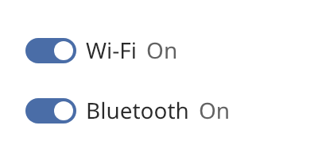

## Toggle

A toggle is an on/off switch. Its effect is immediate, like a light switch. Use a
[checkbox](checkbox.md) for a choice that the user confirms later.



### Create and configure

Pass a label, an initial state and an optional `control_size` to the constructor.

- `set_on` changes the state without calling the handler. `on()` reads it.
- `set_status_text(off_text, on_text)` shows the text for the current state after the label.
  `clear_status_text()` removes it.
- `set_helper_text` shows text below the label.

A toggle has no error state and no mixed state.

### Events

`set_on_change` calls its handler with the new state after the user changes it. A click or Space
changes the state. The toggle is a Tab stop.

### Example

The program `examples/widgets/toggle.cpp` makes two toggles with status text. It clicks the second toggle and prints its new state.

```{.cpp include="examples/widgets/toggle.cpp"}
```
