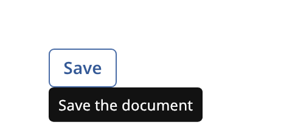

## Tooltip

A tooltip is a short hint on a dark bubble. It names a control that has no visible text, or it
explains a shortened text. `tooltip` is the bubble. `tooltip_anchor` is the part that decides when
to show it.



### Create and configure

Use `tooltip_anchor` inside your own widget. The built-in `avatar` and `chip` do so. The anchor
shows the tooltip after the pointer rests on the widget, or after the widget takes visible keyboard
focus. It hides the tooltip when the pointer leaves, when the focus ring goes away, when the text
becomes empty or when the widget detaches.

1. Add a `tooltip_anchor` member to the widget.
2. Call `set_text(*this, text)` to set the hint.
3. Call `update(*this)` from `on_interaction_changed`. When it returns `true`, call
   `request_animation_frame`.
4. Call `advance(*this, elapsed)` from `on_animation_frame` and return its result.
5. Call `hide(*this)` from `on_detached`.

The constructor takes a delay. The default is 500 milliseconds. `visible()` tells whether the
tooltip shows. Without an [overlay host](overlay_host.md) above the widget, nothing shows.

To show a tooltip without an anchor, call `overlay_host::show_hover_popup` with a `tooltip` and the
bounds of the widget. The example does this.

### Events

A tooltip does not handle input. Its bubble is non-modal, so the pointer passes through it.

### Example

The program `examples/widgets/tooltip.cpp` shows a tooltip below a button with a hover popup and prints that it is visible.

```{.cpp include="examples/widgets/tooltip.cpp"}
```
