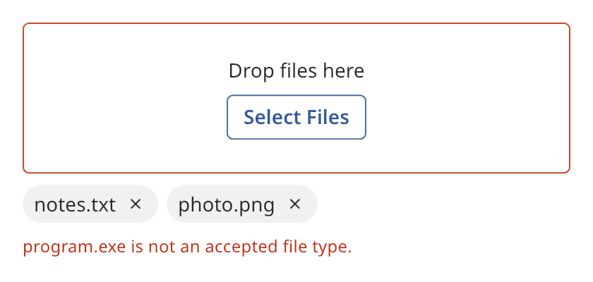

## Uploader

An uploader collects files from a file dialog or from files that the user drops on it. It lists the
files as removable chips. It holds paths only. Your program reads and sends the files.



### Create and configure

Pass a name, an `uploader_layout` and an `uploader_behavior` to the constructor.

| Layout | Meaning |
| ------ | ------- |
| `no_drop_zone` | Only the Select Files button. The widget accepts no drops. |
| `compact` | A one-row drop zone with the prompt and the button side by side. |
| `spacious` | A taller drop zone with the prompt above the button. |

| Behavior | Meaning |
| -------- | ------- |
| `immediate` | Files are handed over when chosen. Each chip is busy until you call `finish`. |
| `deferred_single` | The uploader holds one file. A new file replaces it. |
| `deferred_multiple` | The uploader holds files until your program asks for them. |

- `set_accepted_suffixes({".png", ".txt"})` limits the file types. The comparison ignores case. An
  empty list accepts every file.
- `set_prompt` and `set_button_label` change the texts.
- `add_files(paths)` adds files as if the user chose them. It returns the paths that it took.
  A rejected file sets the error message.
- `files()` returns the held paths in the order that they were added. `clear()` removes them.
- `finish(path, succeeded)` ends an upload in the `immediate` behavior. A failure marks the chip as
  an error.
- `set_error_message` sets the text below the chips. An empty text clears the error.
- `select_files()` opens the file dialog from code.

The Select Files button calls the `file_dialog` of the tree. Set it with
`widget_tree::set_file_dialog`. Without a dialog, the button does nothing.

### Events

`set_on_added` calls its handler with the paths that the uploader took, after it lists them.
`set_on_removed` calls its handler with the path of a file that the user removed. While files are
dragged over the drop zone, `dragging()` is `true` and the zone shows the drag state.

### Example

The program `examples/widgets/uploader.cpp` makes an uploader that accepts PNG and text files. It adds two accepted files and one rejected file, and prints the held files and the error message.

```{.cpp include="examples/widgets/uploader.cpp"}
```
